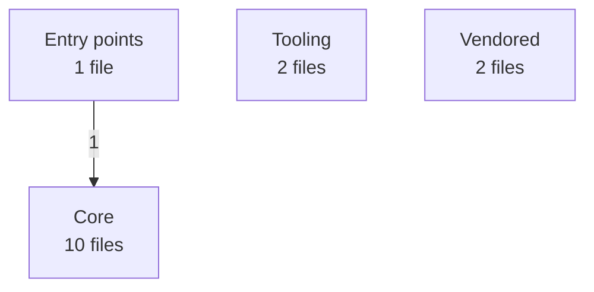
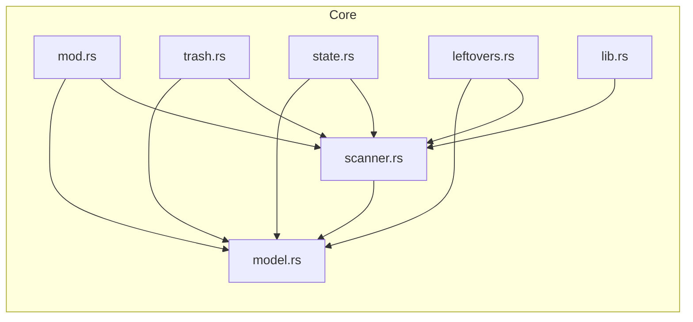

<p align="center">
  
</p>

<h1 align="center">MacCleanUp</h1>

<p align="center">
  A native macOS cleanup app written in Rust. It shows where your disk space goes,<br>
  finds what is safe to clear, and moves nothing until you review it.
</p>

<p align="center">
  macOS 12 or later &nbsp;·&nbsp; Apple silicon &nbsp;·&nbsp; MIT license
</p>


## What it does

- **Shows where the space goes.** A storage bar splits the startup disk into macOS, apps, your files, developer tools, device backups, Mail and Messages, caches, the Trash, swap, purgeable space, and System Data. Click any part to see what it holds.
- **Finds what is safe to clear.** Caches and logs, leftover installers, large files you have not touched in six months, and Cargo and npm build folders.
- **Uninstalls apps cleanly.** An app goes to the Trash with its exact caches and logs. Its settings and data go too, only if you tick the box.
- **Maps any folder.** A treemap draws a folder's contents to scale, and you can open any folder in it.
- **Spots runaway processes.** The System view names any app or system process that kept a processor core busy for the last half minute. It only looks; it never quits anything.
- **Never deletes.** Everything goes to the Trash after a review dialog that lists every path, so you can restore anything until you empty the Trash.

| Overview | Review before anything moves |
| --- | --- |
|  |  |
| **Caches and logs** | **Build folders** |
|  |  |

## Numbers

| Metric | Value | How to check | Date |
| --- | --- | --- | --- |
| Tests that pass | 73 | `cargo test --locked` | 2026-11-26 |
| Tests ignored by default | 2 | `cargo test --locked` | 2026-11-26 |
| Lines of Rust | 8,783 | `git ls-files -z '*.rs' \| xargs -0 awk '1' \| wc -l` | 2026-11-26 |

## Install

MacCleanUp runs on Macs with Apple silicon (M1 or later) and macOS 12 or later. It is one self-contained app: nothing else needs to be installed, and it keeps no settings files.

### Download

1. Download `MacCleanUp-<version>.dmg` from [Releases](https://github.com/dominicferri/MacCleanUp/releases) and open it.
2. Drag MacCleanUp onto Applications, or double-click it right in the disk image to run it without installing.

To carry it on a thumb drive, copy the `.dmg` to the drive and open it on any Apple silicon Mac. A drive formatted as exFAT or FAT32 adds hidden `._` files to an app copied onto it directly; that copy still opens, but the disk image keeps the app exactly as it was signed.

MacCleanUp is ad-hoc signed, not notarized. The first time you open a copy you downloaded, macOS may say it cannot verify the developer. Open System Settings, then Privacy & Security, and click Open Anyway.

### Build from source

The build needs Rust 1.85 or later (from [rustup](https://rustup.rs)), the Apple silicon target, and the Xcode Command Line Tools for `codesign` and `hdiutil`:

```sh
xcode-select --install
rustup target add aarch64-apple-darwin
git clone https://github.com/dominicferri/MacCleanUp.git
cd MacCleanUp
./scripts/build-app.sh      # build/<version>/MacCleanUp.app
./scripts/build-dmg.sh      # build/<version>/MacCleanUp-<version>.dmg
```

The app is built for Apple silicon only. macOS 27 warns that apps carrying Intel code will not open in macOS 28, and every Mac that runs macOS 28 has Apple silicon.

`MacCleanUp.app/Contents/MacOS/MacCleanUp --version` prints the version without opening a window.

## Views

A sidebar lists the views. Lists have a details panel on the right that shows where the item lives, its size, when it last changed, what it is, and what happens when it moves to the Trash. The status bar shows the last result, a progress bar for any running scan, and a Stop button.

- **Overview:** free space, and a storage bar. At launch the bar shows macOS (the System, Preboot, Recovery and Update volumes), Applications, Caches and logs, Swap and sleep image (the VM volume), and Purgeable space (Time Machine local snapshots and other space macOS frees by itself). **Measure your files and more** adds Your files (Desktop, Documents, Downloads, Movies, Music, Public, and Pictures without the Photos library), Developer tools (`~/Library/Developer`, `.cargo`, `.rustup`, `.npm`, and Homebrew, without the caches already listed), iPhone and iPad backups, Mail and Messages, and the Trash. The rest is System Data and other files. A part that macOS does not let MacCleanUp read is left out and named under the bar; Full Disk Access includes it. Below the bar, each cleanup area has its total and a button to review it.
- **Storage:** the same parts as a list. Click a part in the list, on the bar, or in the Overview legend to see what it holds: the macOS volumes, the largest apps and caches, the largest folders in Your files and Developer tools (click one to open it in the disk map), each device backup, the items in the Trash, swap in use, and the Time Machine local snapshots by date. System Data has a button that opens your Library in the disk map.
- **Caches and logs:** user caches, logs, temporary files, Xcode DerivedData, Xcode device support files (iOS, watchOS, tvOS, and visionOS), CoreSimulator caches, and the npm download cache. Every item starts unselected.
- **Applications:** apps in `/Applications` and `~/Applications`, including one nested level, with version, bundle ID, size, and last change. The details panel lists exactly what uninstall moves: the app plus its exact bundle-ID cache and log folders. A checkbox, off for every app, also moves the app's settings and data named after its exact bundle ID in `~/Library`: `Application Support/<id>`, `Preferences/<id>.plist`, `Saved Application State/<id>.savedState`, `HTTPStorages/<id>`, and `WebKit/<id>`. The panel lists each of these paths before you tick the box. Documents, containers, group containers, and folders with any other name always stay. Most browsers keep their profiles under another name, so those stay too; Opera keeps its profile in `Application Support/com.operasoftware.Opera`, so for Opera the option moves it. Containers are left out because macOS asks for permission before another app's container can be read or moved.
- **Installer files:** `.dmg`, `.pkg`, `.mpkg`, `.iso`, and `.xip` files, plus `.pkg` and `.mpkg` bundle folders, in `~/Downloads`, `~/Desktop`, `~/Documents`, `~/Public`, `~/Library/Downloads`, and iCloud Drive's Downloads folder, directly or one folder below. ZIP archives are not inspected.
- **Large old files:** files that use 1 GB or more on disk and have not changed for 180 days, anywhere in the home folder except `~/Library` and the Trash.
- **Build folders:** Cargo `target` folders that contain `CACHEDIR.TAG`, and npm `node_modules` folders next to a `package.json`, anywhere in the home folder except `~/Library` and the Trash.
- **Leftovers:** two groups, both unselected. *Startup items, program gone* are launch agents and daemons in `~/Library/LaunchAgents`, `/Library/LaunchAgents`, and `/Library/LaunchDaemons` whose program path macOS reports as not found. A program on a disk that is not connected, or in a folder MacCleanUp cannot open, is not reported. *Possible leftovers* are entries named after a bundle ID that no installed app uses: in `Application Support`, `Preferences`, `HTTPStorages`, `WebKit`, and `Saved Application State` in `~/Library`, in `/Library/Application Support`, and privileged helpers in `/Library/PrivilegedHelperTools` with their launch daemons. Installed apps are found in `/Applications`, `~/Applications`, and `/Library/Application Support`, including vendor folders, helpers inside app bundles, and the helpers an app declares. A name counts as used when any installed app shares its vendor prefix. Apple names, app-group names of installed apps, and names that code libraries write under their own vendor are never listed. These are guesses from names, and a command-line tool may still use one. Items in `/Library` move through Finder, which asks for an administrator password. A moved startup item that is already running stops at the next restart or log-out.
- **Disk map:** the items in a folder drawn to scale as a treemap, with a sortable list below it. Click a tile or row for details; double-click a folder to open it. Use Up, the breadcrumb path, or the path field (`~` is accepted) to move around. Sizes of large folders are kept until you quit, so going back to a folder you already measured is fast. **Measure again** discards them, and any Trash operation discards the sizes it changed.
- **System:** processor, macOS version, memory, startup disk use, load average, and uptime, updated every 2 seconds, plus the size of the Trash and the number of Time Machine local snapshots. If macOS does not let MacCleanUp read the Trash, the size shows as unavailable, not as zero. A performance check lists any app or system process that averaged 80% or more of one processor core over the last 30 seconds (a result appears after 20 seconds on the page). It only reads CPU time; it never quits or pauses anything.
- **Activity:** every Trash operation since the app opened, with each path that moved and any failures.

Caches and Applications scan together when the app opens. Installer files, Large old files, Build folders, Disk map, and the storage measurement wait for a click, because they read Desktop, Documents, and Downloads, and macOS may ask MacCleanUp for access to those folders the first time. Leftovers also waits for a click; it reads only the Library folders named above. The file searches do not open `~/Library`, the Trash, app bundles, or Photos libraries, and do not cross onto other volumes.

Lists can be filtered by name and sorted by name, size, or last change.

## Keyboard

| Key | Action |
| --- | --- |
| `Cmd-1` to `Cmd-9`, `Cmd-0` | Switch to one of the first ten views |
| `Cmd-R` | Scan the current view again |
| `↑` / `↓` | Move through a list |
| `Space` | Select the highlighted item |
| `Esc` | Stop a running scan |

The review dialog lists every path that will move and its size. `Return` and `Esc` both cancel it; only a click on **Move to Trash** proceeds. A Trash operation cannot be stopped, and the window stays open until it finishes.

## Safety model

- No automatic deletion, permanent deletion, Trash emptying, or permanent-delete fallback.
- Scanning and selection happen before an explicit confirmation.
- Cleanup paths must remain inside fixed user-owned roots. Relative paths, `..`, control characters, root directories, and missing paths are rejected.
- Each kind of item has its own guard, checked again just before it moves. Large files and build folders must be inside the home folder, outside `~/Library` and the Trash, and not protected. A build folder must still contain `CACHEDIR.TAG`, or sit next to a `package.json`. App settings and data must be exactly one of the listed names inside the real `~/Library` folder.
- The disk map protects the home folder itself, its standard top-level folders, shell profiles, `.ssh`, `.gnupg`, `.vault`, `~/Library/Keychains`, and anything outside the home folder, including external volumes. The check ignores letter case.
- A bundle ID read from an app's `Info.plist` is used in a path only if it is one plain name: not empty, no `/`, no leading `.`, and no control characters.
- File and parent device/inode identities are captured during scanning and rechecked immediately before each Trash operation, including the caches, logs, and data that uninstall moves with an app. Changed or unknown identities are skipped.
- Directory sizing does not follow symlinks or cross mounted filesystems. Partial sizes, including app sizes, are shown in amber; unavailable bytes are never shown as an empty folder. One unreadable item in a disk map folder is skipped and listed, and the rest of the folder still shows.
- App caches and data stay if the app move fails, or if another unselected installed copy uses the same bundle ID. The uninstall preview and the operation use the same function, so they cannot disagree.
- Trash failures are reported item by item.
- When macOS answers that MacCleanUp has no permission to move an item, MacCleanUp asks Finder to move that one item to the Trash. This can happen in a Documents or Desktop folder that cloud sync manages. Finder may ask for an administrator password when the item belongs to another user. Put Back still works. The path goes to the script as an argument, not as script text. The first time, macOS asks whether MacCleanUp may control Finder. MacCleanUp never runs itself as root: a move made as root would go to root's Trash, where Put Back does not work.
- MacCleanUp does not terminate running apps. Close an app before removing its caches or uninstalling it.
- The only other programs MacCleanUp starts are `tmutil listlocalsnapshots /` and `diskutil apfs list -plist`, which read the snapshot list and the volume sizes, `ps -A -o pid=,time=,comm=`, which reads CPU time for the performance check, `open` and `open -R` for the Finder buttons, and `osascript` for the Finder fallback above. It runs no shell cleanup scripts and no privileged commands, and it never signals, pauses or quits another process.

## Sizes and speed

Sizes are space used on disk (allocated blocks), and a file with several hard links counts once per measured item, as `du` reports. Sparse files count only the blocks they use. APFS clones that share blocks can still be counted more than once.

Scans measure folders on all processor cores. A test checks the measured size against `du -sk` on a folder that holds a hard link and a sparse file. **Stop** ends a scan within a moment, and a stopped view stays unscanned until you scan it again.

## Build and test

```sh
cargo test
cargo clippy --all-targets -- -D warnings
./scripts/build-app.sh
```

The build creates `build/<version>/MacCleanUp.app` from a fresh staging folder, verifies its plist and ad-hoc signature, and checks that the binary contains only `arm64` code. `build-dmg.sh` packs that app with an Applications shortcut and a short read-me into a compressed disk image, then mounts the image read-only to check the signature, the architecture and the version inside it. Both scripts refuse to overwrite an existing build of the same version.

The interface tests run headless through `egui_kittest` and never open a window. Set `MACCLEANUP_SHOTS=<folder>` to save a PNG of each tested screen; the screenshots on this page come from those tests.

Two tests do not run by default. One needs a root-owned file that only `sudo` can make, and the other reads the real Library folders of the Mac it runs on. The comment above each test gives the command that runs it.

In an iCloud-synced Desktop or Documents folder, macOS can attach `FinderInfo`, `macl`, or provenance attributes after packaging or first launch. A later strict signature check can then report `resource fork, Finder information, or similar detritus not allowed`, while the non-strict check passes.

## Source layout

- `src/scanner.rs`: bounded read-only inventories and searches, parallel on-disk sizing, containment, and identity checks
- `src/trash.rs`: reviewed operations through `NSFileManager.trashItemAtURL`, the Finder fallback, and the shared uninstall preview
- `src/leftovers.rs`: startup items whose program is gone, and settings, data, or privileged helpers named after apps that are not installed
- `src/system.rs`: macOS system metrics, volume use, the storage breakdown, Trash size, and local snapshots
- `src/model.rs`: the item types that the library and the window share, and size formatting
- `src/lib.rs`: the library's module list
- `src/gui/state.rs`: views, background jobs, selection, review dialogs, and the activity log, independent of drawing
- `src/gui/mod.rs`: window layout, views, dialogs, and headless interface tests
- `src/gui/theme.rs`: colors, fonts, and widget style
- `src/gui/treemap.rs`: squarified treemap layout for the disk map
- `src/main.rs`: command-line flags and window setup

<!-- diagrams:start -->
## Project map

MacCleanUp has two parts: a library that finds, sizes and guards files, and an egui window that drives it. The window is part of the binary, so the library does not depend on the interface.

- src/scanner.rs and src/model.rs have the most incoming links, 6 each. src/scanner.rs holds the path guards and identity checks that src/trash.rs runs before every move.
- Only src/trash.rs moves anything to the Trash. The window reaches it through accept_confirmation in src/gui/state.rs.
- src/leftovers.rs came with version 0.5.0. It finds startup items and app data that no installed app uses, and it reuses the guards in src/scanner.rs.
- src/gui/mod.rs is the largest file and the most changed, at 3,019 lines and 8 commits.

### Architecture

src/main.rs is the only entry point. It hands everything to the Core layer, which holds both the library and the window. Tooling is the two build scripts. The two Vendored files are not borrowed code. They are one-line stubs in the test fixture's node_modules folders, so the build-folder search has something to find.



### Dependencies

src/scanner.rs and src/model.rs are the two files that most others depend on. src/trash.rs calls the guard and identity functions in src/scanner.rs before each move.

7 of 11 files: the most connected ones, test files left out, joined by the 10 strongest of the 26 links between them.



### Composition

The Rust source is 8,783 lines in 11 files. Cargo.lock is most of the rest, at 4,638 lines.

51 files, 13999 lines.

| Language | Files | Lines |
|---|---:|---:|
| Rust | 11 | 8783 |
| Lockfile | 1 | 4638 |
| Docs | 3 | 267 |
| Shell | 2 | 155 |
| Other | 27 | 104 |
| TOML | 1 | 37 |
| Config | 3 | 12 |
| JavaScript | 2 | 2 |

### History

The history is short. scripts/build-app.sh changes with the source files because each release raises its version number, not because the code depends on it.

13 commits, 2026-11-23 to 2026-11-24.

| Hotspot | Commits | Lines |
|---|---:|---:|
| `src/gui/mod.rs` | 8 | 3019 |
| `src/gui/state.rs` | 7 | 1576 |
| `src/scanner.rs` | 4 | 1602 |
| `src/system.rs` | 6 | 834 |
| `src/trash.rs` | 5 | 462 |
| `scripts/build-app.sh` | 7 | 87 |
| `src/model.rs` | 3 | 154 |
| `src/gui/theme.rs` | 2 | 134 |

src/gui/mod.rs, src/gui/state.rs and src/scanner.rs are complex, and together they hold 6,197 of the 8,783 Rust lines. Most of the risk sits in those three files.

| Changed together | Commits | Linked in code |
|---|---:|---|
| `src/gui/mod.rs` + `src/gui/state.rs` | 7 | yes |
| `scripts/build-app.sh` + `src/gui/mod.rs` | 6 | no |
| `scripts/build-app.sh` + `src/gui/state.rs` | 6 | no |
| `scripts/build-app.sh` + `src/system.rs` | 6 | no |
| `src/gui/mod.rs` + `src/system.rs` | 6 | yes |
| `src/gui/state.rs` + `src/system.rs` | 6 | yes |
| `scripts/build-app.sh` + `src/trash.rs` | 4 | no |
| `src/gui/mod.rs` + `src/scanner.rs` | 4 | yes |

<!-- diagrams:end -->

## Reference

Mole 1.74.0 (GPL-3.0) supplied the behavior and safety requirements reviewed for this independent implementation. No Mole scripts or binaries are bundled or invoked.

Version 0.5.0 does not implement Mole's Optimize maintenance tasks (it has only the read-only CPU check), Purge, Slim, Touch ID, update, or administrator-only workflows.

## License

MIT
